# PhotoScout

A map of photography spots, the events worth shooting, and when the light works at them. A new instance is private: people sign in with Google or Discord, then add their own spots. An admin can open the public map to visitors (see [Signing in](#signing-in)).

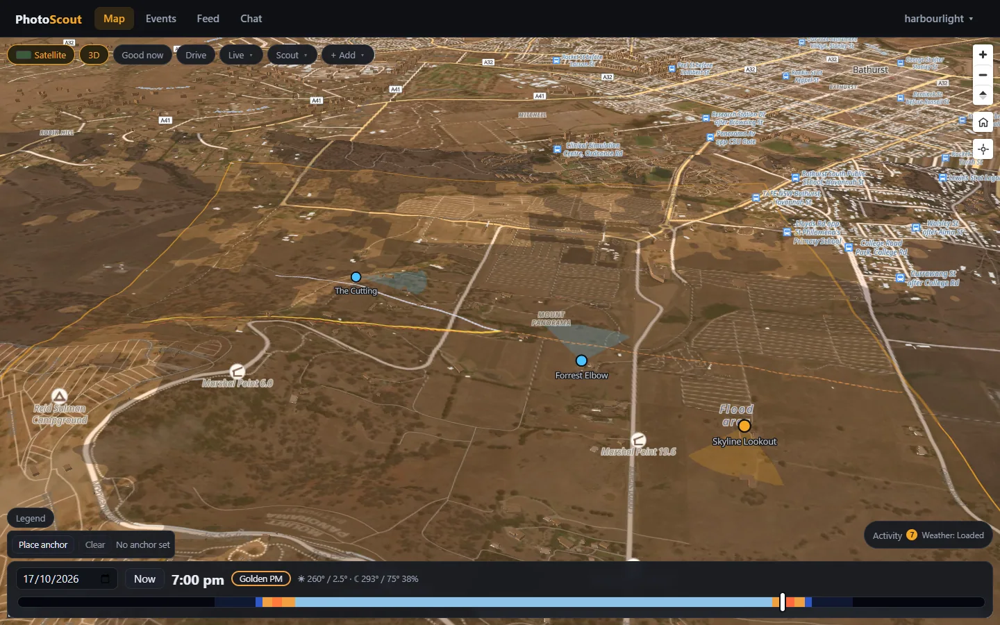

## What it does

- **Spots and places.** Save spots (a point, a facing direction, a field of view, notes, photos, "good times") grouped into places with outlines. GPS is read from uploaded photos, then stripped before they're stored.
- **Light on the map.** A time slider drives sun and moon position, golden and blue hour, terrain and building shadows, and sun/moon alignment with each spot's facing direction.
- **Plan shoot.** Pick a spot and a date range, tick what you're after (golden light, open shade, alignment, clear sky, trains…), and get ranked time windows. Drill into a day's light, shade and weather, preview the view from the spot, or find the exact dates the sun lines up with a bearing on a small interactive map.
- **Live feeds.** Planes overhead (adsb.lol), NSW passenger trains and live traffic cameras (TfNSW, needs a key), a rail network layer with crowdsourced freight sightings, NSW RFS fire incidents, aurora (NOAA Kp), weather and rain radar, tides and swell, road quality from OpenStreetMap, Wikimedia Commons photos, and OpenStreetMap suggestions you can turn into spots.
- **Events.** The events engine runs inside this server: it gathers upcoming events from the sources an admin switches on, places and culls them, and shows them on an Events page, a Calendar and a clustered map layer. Signed-in users keep their own shortlist, say they're going, invite each other and hide what they don't want, and can post their own meets and cruises (with a route to drive and a meeting point). Admins manage areas, sources, the crawler, AI models, notifications (Discord, Matrix) and busy-place density under Settings.
- **Drive.** An in-car screen (`/drive`) with turn-by-turn directions to a searched, tapped or saved destination, or along a saved route. Heading-up map that follows you, speed, spoken prompts, rerouting, and the screen kept awake. Start or join a **convoy** (`/convoy`) to see each other live on the map. Install PhotoScout to your home screen from the browser's menu and it opens like an app.
- **Community.** A feed of check-ins, rides, gear and events (everyone's, or only people you follow), a short-lived public chat room, and a Kit page for your bio, cars and bikes, and camera gear. Reports and suggested spots go to a moderation queue for admins and moderators.
- **Convoy across the app.** An active convoy stays connected as you move between pages. Its map widget and Drive controls show connection state, members, unread chat and shared destinations. Convoy chat is private to members, keeps up to 50 messages for 30 minutes in server memory, and catches up after a reconnect. Large quick-update buttons, optional spoken messages and change announcements, device notifications, and a screen-awake setting are under Riding & audio. Navigation prompts take priority over chat audio. Mobile browsers can suspend location, audio and networking when the app is hidden or the screen locks; keep it visible while riding. Rooms and chat are lost on a server restart.
- **Smooth member movement.** Convoy pins blend new GPS fixes and briefly predict motion, with estimates marked `~`. Prediction stops after three seconds or 90 metres. [Mobile behavior](docs/convoy-mobile.md) explains Android/iPhone installation, notifications and background tracking limits.
- **Plugins.** Extra map layers, panels, Settings tabs, Drive alerts and background jobs that you install without changing the app. See [Plugins](#plugins).
- **Import, export, share.** KML/KMZ, GPX, GeoJSON, CSV and Google Takeout in; GeoJSON, GPX or a zip with photos out. Share links, and syncing spots from other instances.
- **Accounts.** Sign in with Google or Discord; there are no passwords. The instance is private by default (everything needs a sign-in); an admin can allow public reads under Settings > Instance (or set `PUBLIC_READS`), and then anonymous visitors see public spots, places and routes, and the events. Signed-in contributors add and edit their own; moderators handle reports; admins manage everyone's, the users and the settings.

## Screenshots

| | |
|---|---|
|  Map at sunset: sun and moon rays, terrain and building shadows |  A spot: facing wedge, good times, the day's light, nearby events |
| 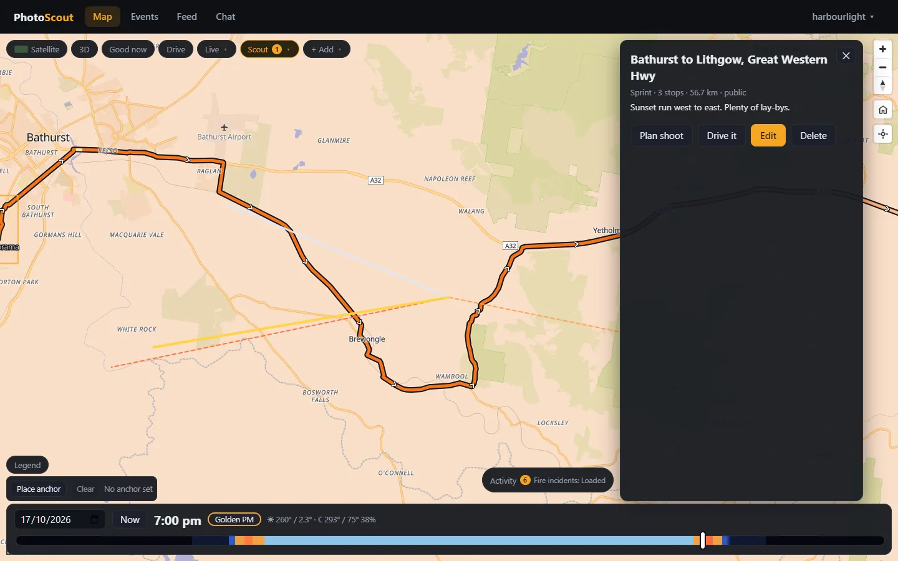 A saved route | 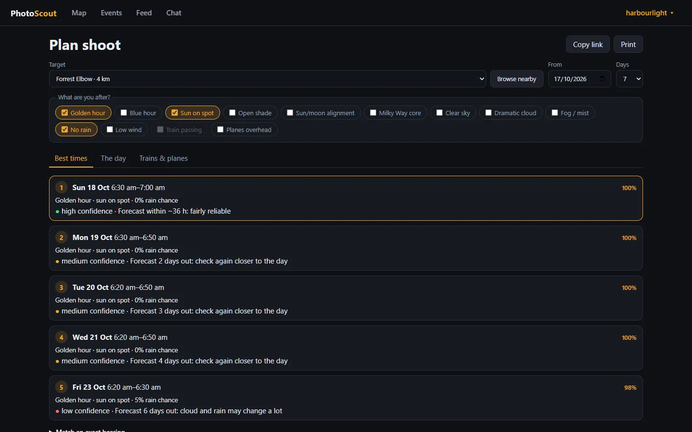 Plan shoot: ranked windows |
| 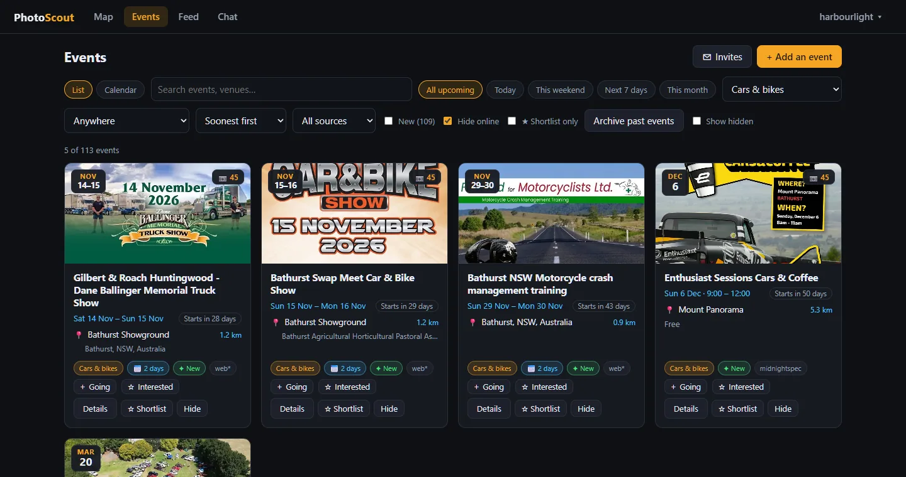 Events, filtered to Cars & bikes | 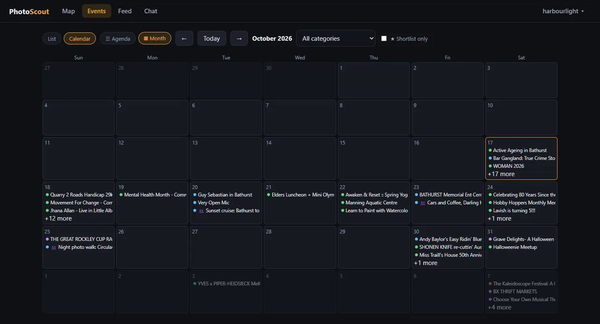 Calendar, month view |
| 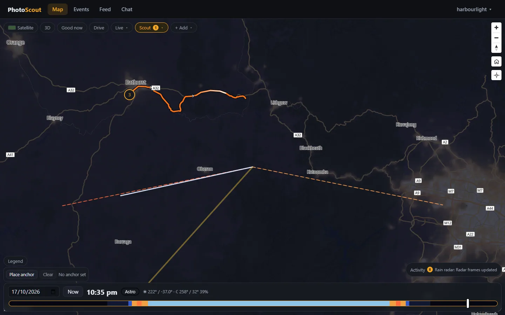 Night lights | 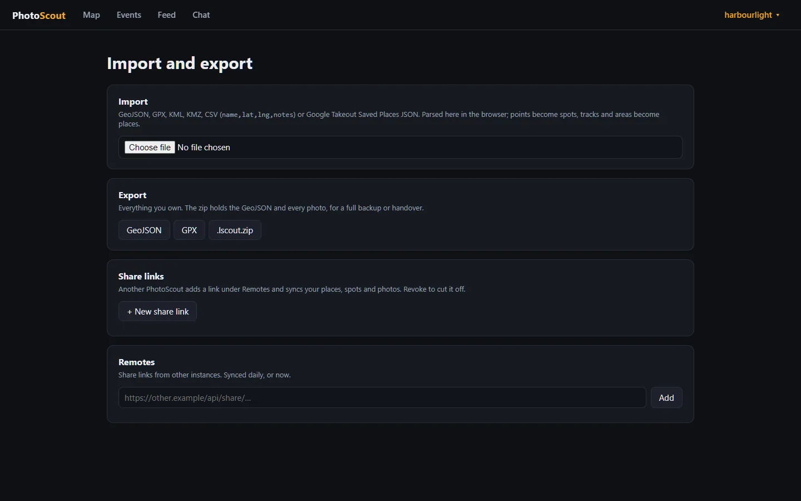 Import, export, share |
| 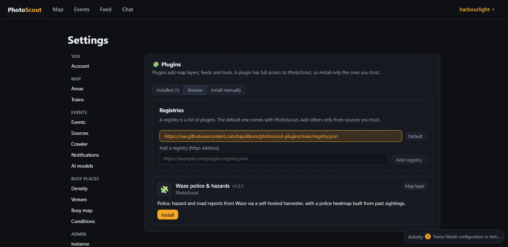 Settings > Manage plugins, browsing a registry | 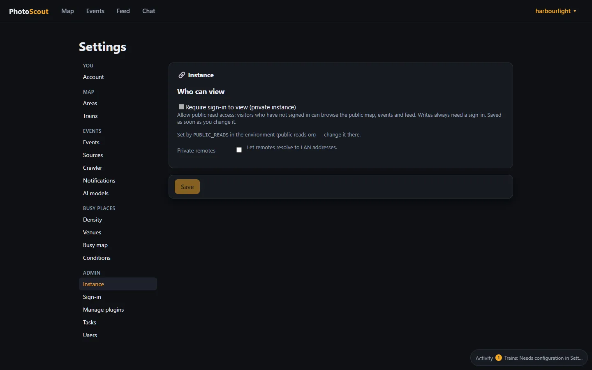 Settings > Instance: who can view |
| 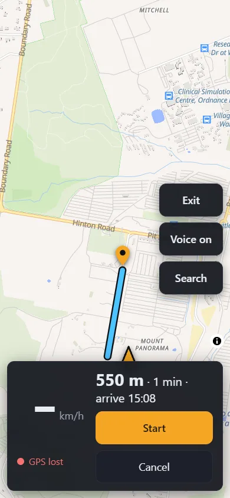 Drive, previewing a route to a tapped destination | 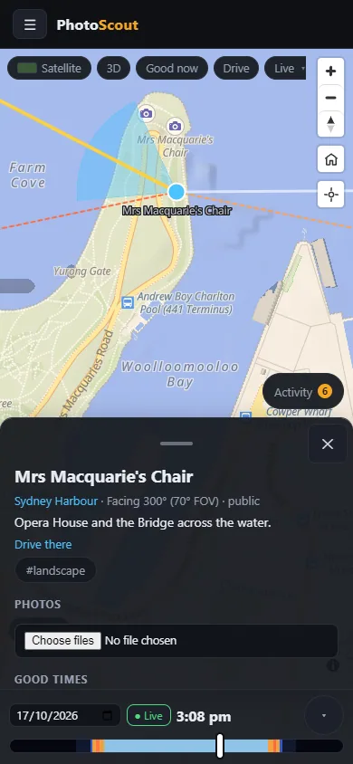 Phone layout |

The events shown are whatever the engine found for the demo area; they are other people's listings.

## Run it

Needs Node 24.

```bash
npm install
npm run dev
```

Open http://localhost:5174. The API runs on :3003 and Vite proxies `/api` to it. The instance is private, so you need a provider set up (below) to sign in. To look around without one, start it with `PUBLIC_READS=1`: the public map is then open, though adding anything still needs a sign-in.

With Docker, using the published image:

```bash
docker compose pull && docker compose up -d
```

Then open http://localhost:3003 (set `PUBLIC_URL` to match, see below). The compose file also starts the event crawler and an OSRM routing server (see Driving directions).

> :3003 in dev serves the last `npm run build` of the web app, not your working copy. Use :5174 while developing.

### Signing in

Sign-in goes to Google or Discord and back; this app keeps the provider's id for you, a display name to make a handle from, and your picture. No email address is asked for. A provider only appears on the sign-in page once both its client id and secret are set, so configure one or both.

1. Create an OAuth client with the provider and give it the redirect URL `<PUBLIC_URL>/api/auth/google/callback` (or `.../discord/callback`). For local development that is `http://localhost:5174/api/auth/google/callback`.
2. Set `PUBLIC_URL` to the address people reach the app at, with no trailing slash. It has to match exactly: it builds the redirect URL, and a write request whose `Origin` is anything else is refused.
3. Put the client id and secret in the environment (below), or enter them under Settings > Sign-in once you have an admin. The environment wins when it sets a provider.
4. Sign in, then open Settings > Account. It shows your account id (`discord:1234…`). Put it in `ADMIN_IDS` and sign in again to become an admin. Everyone else is a contributor; admins can make moderators under Settings > Users.

The session cookie is `Secure`, so run it behind HTTPS. Browsers make an exception for `localhost`.

### Plugins

A plugin is a zip with a `plugin.json` and a server half, a web half, or both. It can add routes and a database, background tasks, map layers, legend toggles, side panels, Settings tabs and Drive alert sources. Admins manage them under Settings > Manage plugins: install from a registry, upload a zip, or add another registry (https only). A plugin has full access to the instance, so install only what you trust.

- **Registry.** The default is [kapsikkum/photoscout-plugins](https://github.com/kapsikkum/photoscout-plugins); `PLUGIN_REGISTRY_URL` points a fresh instance somewhere else.
- **Bundled.** Radio Garden (a radio panel with stations on the map) ships with the app and is installed at startup. An admin can disable or uninstall it.
- **Waze police and hazards.** Not part of core. It lives in [kapsikkum/photoscout-plugin-waze](https://github.com/kapsikkum/photoscout-plugin-waze) and is listed in the registry. Installed, it adds the Police & hazards layer, a police heatmap and Drive warnings. Its reports come from an Android emulator bridge you host yourself: see the plugin repository's `harvester/README.md` and `npm run waze:setup`.
- **Writing one.** [docs/plugins/authoring.md](docs/plugins/authoring.md) walks through it, with a starter in `docs/plugins/template` and the contract in `packages/plugin-sdk`. `npm run plugin:validate -- plugins/<name>` checks a manifest and `npm run plugin:build -- plugins/<name>` makes the zip.
- **Safe mode.** `PHOTOSCOUT_SAFE_MODE=1` starts the server without running any plugin, for when one misbehaves.

### Driving directions (OSRM)

Drive and snapped routes ask this server for a route (`/api/route`), and the server asks an [OSRM](https://project-osrm.org) instance. In development that is the public demo, which is not for real use. For production, docker-compose includes an `osrm` service on the official image; it needs a one-time preprocess of the Australia extract from Geofabrik. Extracting wants a few GB of memory and takes a while; serving afterwards wants a few GB.

```bash
mkdir -p osrm && cd osrm
curl -LO https://download.geofabrik.de/australia-oceania/australia-latest.osm.pbf

# osrm-extract, osrm-partition and osrm-customize, in that order (the multi-level Dijkstra pipeline)
docker run --rm -v "${PWD}:/data" ghcr.io/project-osrm/osrm-backend osrm-extract -p /opt/car.lua /data/australia-latest.osm.pbf
docker run --rm -v "${PWD}:/data" ghcr.io/project-osrm/osrm-backend osrm-partition /data/australia-latest.osrm
docker run --rm -v "${PWD}:/data" ghcr.io/project-osrm/osrm-backend osrm-customize /data/australia-latest.osrm
cd .. && docker compose up -d
```

The compose file mounts `./osrm` into the `osrm` container and sets `OSRM_URL=http://osrm:5000` for the app. Re-run the three steps on a fresh extract now and then to pick up new roads. The app caches routes for five minutes and asks OSRM for no more than 60 routes a minute per signed-in user.

## Configuration

| Variable | Default | Meaning |
|---|---|---|
| `API_PORT` | `3003` | Server port. |
| `PUBLIC_URL` | `http://localhost:5174` (compose: `http://localhost:3003`) | Where this app is reached from outside, no trailing slash. Sign-in redirects back to it. |
| `GOOGLE_CLIENT_ID`, `GOOGLE_CLIENT_SECRET` | — | Turns on "Continue with Google". Can also be set under Settings > Sign-in; the environment wins. |
| `DISCORD_CLIENT_ID`, `DISCORD_CLIENT_SECRET` | — | Turns on "Continue with Discord". Same. |
| `ADMIN_IDS` | — | Comma-separated `provider:id` accounts that are admins, e.g. `google:1234,discord:5678`. Takes effect on their next sign-in. |
| `PUBLIC_READS` | — | Whether visitors who have not signed in may read the public map. Unset, the instance is private: everything but signing in needs a session. `1` or `true` allows public reads; any other value (`0`, `false`) keeps it private. Wins over the Settings > Instance switch. |
| `TRUST_PROXY` | — | Behind a reverse proxy: hops to trust `X-Forwarded-For` from. The proxy must also pass WebSocket upgrades on `/ws` (convoys and live chat); without it chat falls back to polling and convoys do not connect. |
| `DATA_DIR` | `data/` in the repo (`/app/data` in the image) | Where the database and photos are kept. |
| `TFNSW_API_KEY` | — | TfNSW Open Data key, for passenger trains and live traffic cameras. Can also be set under Settings > Trains; the environment wins. |
| `EVENT_SCOUT_DATA` | `<DATA_DIR>/events` | Where the events engine keeps its own database and flyers. (The name is left over from when it was a separate service.) |
| `CRAWLER_URL` | `http://crawler:3002` in compose | Where the event crawler listens. Settings > Crawler can point elsewhere. |
| `OLLAMA_URL` | `http://localhost:11434` | Default address for an Ollama AI model service. AI models (Ollama, OpenAI-compatible servers, Claude, Gemini) are set up under Settings > AI models. |
| `OSRM_URL` | `https://router.project-osrm.org` | Driving directions for Drive and snapped routes. The default is the public OSRM demo, for development only; in production point it at your own (above). docker-compose sets it to the bundled `osrm` service. |
| `ADSB_URL` | `https://api.adsb.lol` | Planes feed; airplanes.live also works. |
| `OVERPASS_URL` | — | OpenStreetMap Overpass server to try first (rail, suggestions); public mirrors are tried after it. |
| `PLUGIN_REGISTRY_URL` | the registry above | The plugin registry an instance starts with (https only). |
| `PHOTOSCOUT_SAFE_MODE` | — | `1` starts without running any plugin. |
| `TZ` | `Australia/Sydney` in compose | What counts as "today" and when daily tasks run. |

Any feed without its key shows "not configured" instead of failing; until an admin sets a location under Settings > Events, the Events page is simply empty. The Waze plugin has its own keys (`WAZE_ALERT_SERVICE_URL`, `WAZE_HARVESTER_API_KEY`); see `.env.example`.

## How it works

```
server/   Express API, SQLite (node:sqlite), feeds and background tasks
  src/feeds/    planes, trains (GTFS static + realtime), freight, cameras, fires, weather, marine, aurora
  src/events/   the events engine: sources, refresh, culling, geocoding, density, notifications, its tasks
    llm/          AI model services (Ollama, OpenAI-compatible, Claude, Gemini) and the router that picks one
  src/events.ts the events list for visitors (cut down from the engine, cached a minute) and each user's star/hide
  src/plugins/  the plugin runtime: manifests, store, registry install, bundled plugins, routes
  src/sources/  OSM rail, roads and candidates, Wikimedia Commons
  src/tasks/    scheduled background jobs (remote sync, feed imports)
web/      React 19 + Vite + MapLibre
  src/map/      layers, sun/moon maths, shadow workers, geometry helpers
  src/pages/    Map, Events, Calendar, Plan shoot, Drive, Convoy, Feed, Chat, Kit, Settings, Import/Export
  src/plugins/  loads each plugin's web half into the map, panels and Settings
packages/
  plugin-sdk/   the contract plugins are written against (server and web)
plugins/
  radio-garden/ the bundled Radio Garden plugin
services/
  crawler/      standalone event crawler, HTTP service and container
  density/      venue density browser, sampling, storage and rendering package
docs/     API reference, plugin guide (docs/plugins) and research notes
```

- **Sun and moon** positions use [suncalc](https://github.com/mourner/suncalc) in `web/src/map/sun.ts`, all client-side, so the time slider is instant.
- **Shadows** are one raster. Terrain shadows are ray-marched over elevation tiles (AWS Terrain Tiles) in a worker, and building footprints are drawn into the same mask so overlaps don't darken twice.
- **Events.** The engine's own API (`/api/events-admin/*`) is for admins only. Everyone else gets a cut-down list: what the engine has culled or hidden is dropped, only the fields the pages need are passed on, and the result is kept for a minute so visitors can't make the server rebuild it on every request. The crawler, which drives a headless browser against other people's sites, stays a separate container.
- **AI models.** Optional. A service has a provider, a model and the jobs it may do: text (checking and tidying listings), vision (flyers) or chat (the Matrix bot). With several services for one job, the router picks by strategy (least busy, round robin or random) and tries the others if one fails.
- **Service code.** The density implementation lives in `services/density`; the server supplies its existing events database, settings, network guards and scheduler. The crawler source and Dockerfile live in `services/crawler`; local development keeps using `crawler/data` for existing crawler state, and containers use `CRAWLER_DATA`.
- **Plugins.** The server mounts a plugin's routes under `/api/plugins/<id>/`, and they need a session unless the plugin's `plugin.json` declares them `public` and public reads are on. Plugins are installed to the data directory; the web half is a bundle the map loads at runtime.
- **Service activity.** The bottom-right Activity button opens a timestamped activity history on the map and in Settings. It includes feed updates, queued scans and failures, with an Issues only filter. Admins can also see crawler and venue density progress while the log is open. The history stays in the current browser session and is limited to 80 entries.
- **Convoys and chat.** Convoy rooms (up to 30 people) and the chat room live in server memory over a WebSocket. A position is held only as a member's latest and dropped when they leave; chat lines expire after 30 minutes.
- **Remotes and shares.** A share link is a token that returns a GeoJSON bundle. Another instance adds it as a remote and syncs daily. Remote URLs are SSRF-guarded.
- **Trains.** Passenger trains come from TfNSW timetables plus realtime positions. Freight has no public feed ([why](docs/freight-schedule-research.md)), so it's built from logged sightings snapped to the rail network.

Full endpoint list: [docs/api.md](docs/api.md).

### Known limits

- Plane paths are projected 15 minutes by dead reckoning, so turning aircraft drift off.
- Freight prediction stops where a mapped stretch of track ends. It doesn't route across junctions.
- The sun-bearing wedges are approximate near the polar circles.
- Convoy rooms are in memory in one process, so they don't survive a restart or span several instances.

## Contributing

1. Branch off `master`.
2. Make the change, with a test for any non-trivial logic. Tests use `node:test` in `server/test` and `web/test`, and plugins keep theirs beside them. Keep maths and geometry in pure functions so they can be tested without a browser.
3. Check before pushing:
   ```bash
   npm run typecheck
   npm test
   ```
4. Open a PR into `master`. Use [Conventional Commits](https://www.conventionalcommits.org) (`feat(web): …`, `fix(server): …`): release-please builds the changelog and version from them.

CI typechecks and tests every PR, and builds the Docker images (the app and the crawler). Merges to `master` publish `ghcr.io/kapsikkum/photoscout:latest` and `ghcr.io/kapsikkum/photoscout-crawler:latest`.
