# PhotoScout

A map of photography spots, the events worth shooting, and when the light works at them. Visitors can browse the public map; people who sign in with Google or Discord add their own spots.

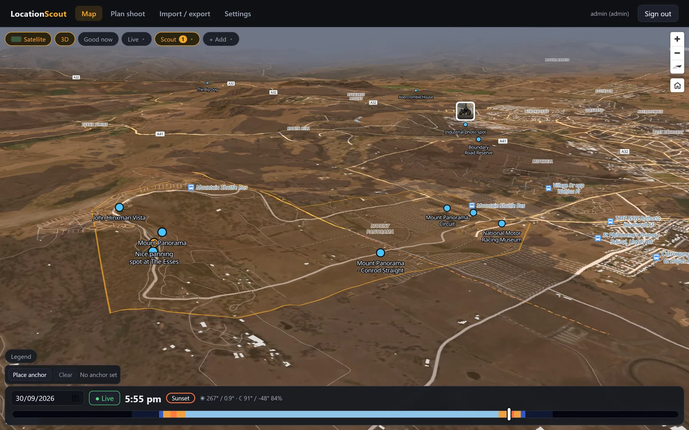

## What it does

- **Spots and places.** Save spots (a point, a facing direction, a field of view, notes, photos, "good times") grouped into places with outlines. GPS is read from uploaded photos, then stripped before they're stored.
- **Light on the map.** A time slider drives sun and moon position, golden and blue hour, terrain and building shadows, and sun/moon alignment with each spot's facing direction.
- **Plan shoot.** Pick a spot and a date range, tick what you're after (golden light, open shade, alignment, clear sky, trains…), and get ranked time windows. Drill into a day's light, shade and weather, preview the view from the spot, or find the exact dates the sun lines up with a bearing on a small interactive map.
- **Live feeds.** Planes overhead (adsb.lol), NSW passenger trains (TfNSW), a rail network layer with crowdsourced freight sightings, nearby crowds from the built-in events engine, Wikimedia Commons photos, and OpenStreetMap suggestions you can turn into spots.
- **Events.** The events engine (what was event-scout) runs inside this server: it gathers upcoming events from the sources an admin switches on, places and culls them, and shows them on an Events page, a Calendar and a clustered map layer. Anyone can browse them; signed-in users keep their own shortlist and hide what they don't want. Admins manage areas, sources, the crawler, the local model and notifications under Settings.
- **Drive.** An in-car screen (`/drive`) with turn-by-turn directions to a searched, tapped or saved destination, or along a saved route. Heading-up map that follows you, speed, spoken prompts, rerouting, and the screen kept awake. Install PhotoScout to your home screen from the browser's menu and it opens like an app.
- **Import, export, share.** KML/KMZ, GPX, GeoJSON, CSV and Google Takeout in; GeoJSON, GPX or a zip with photos out. Share links, and syncing spots from other instances.
- **Accounts.** Sign in with Google or Discord; there are no passwords. Anonymous visitors see public spots, places and routes, and the events. Signed-in contributors add and edit their own; admins manage everyone's, the users and the settings.

## Screenshots

| | |
|---|---|
| 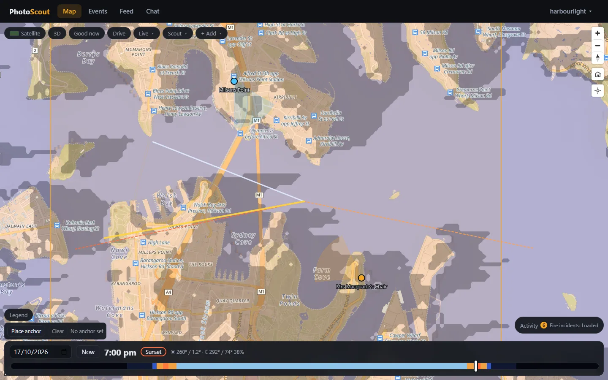 Map at sunset, sun and moon rays | 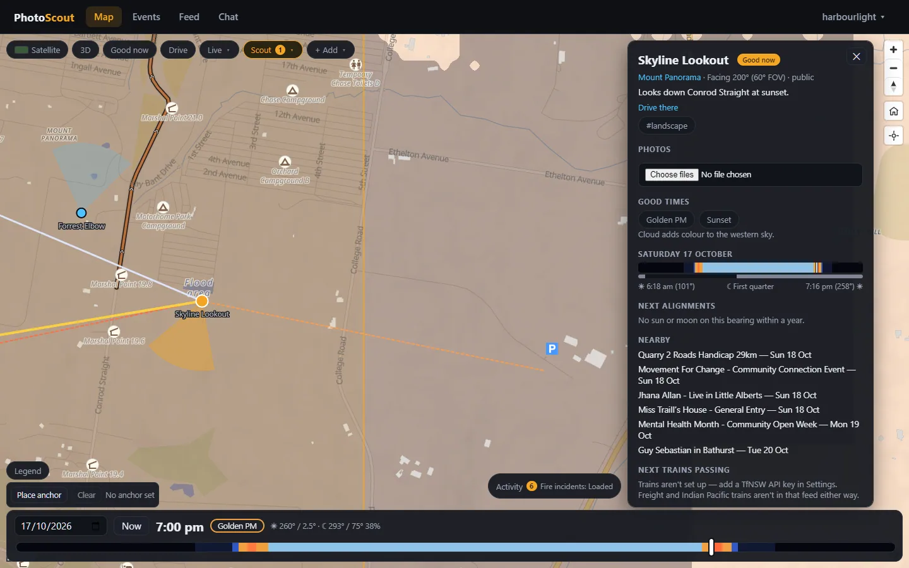 A spot: facing wedge, photos, good times |
| 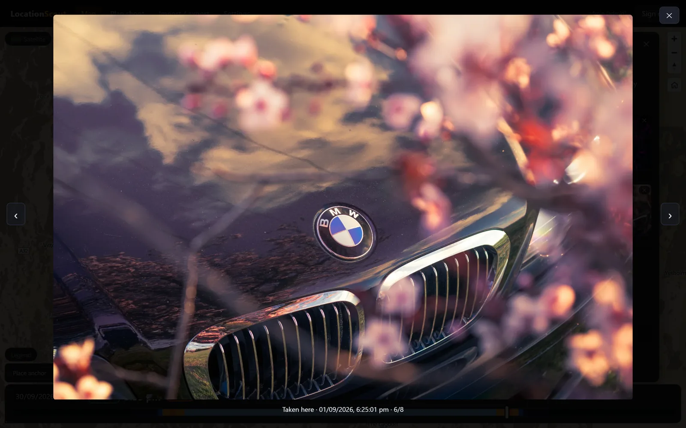 Photo viewer | 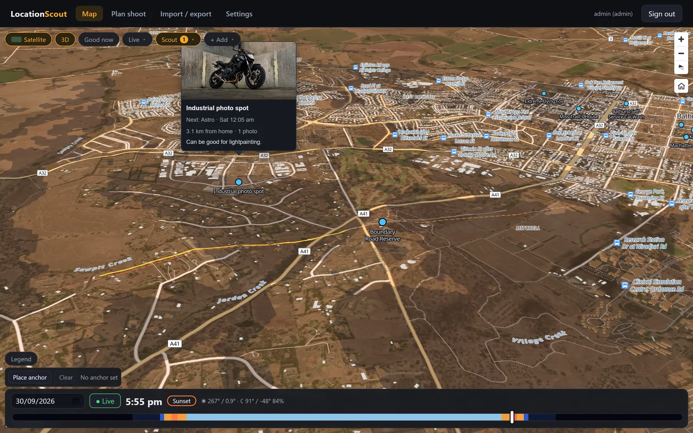 Hover a spot for its photo |
| 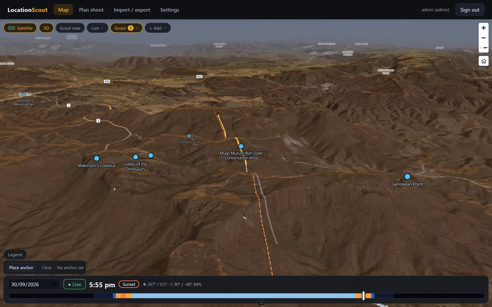 3D terrain, Capertee Valley | 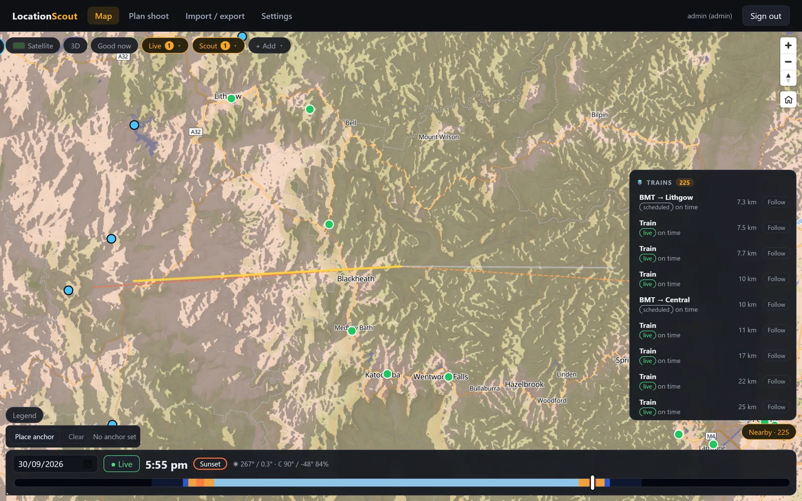 Live and scheduled trains |
| 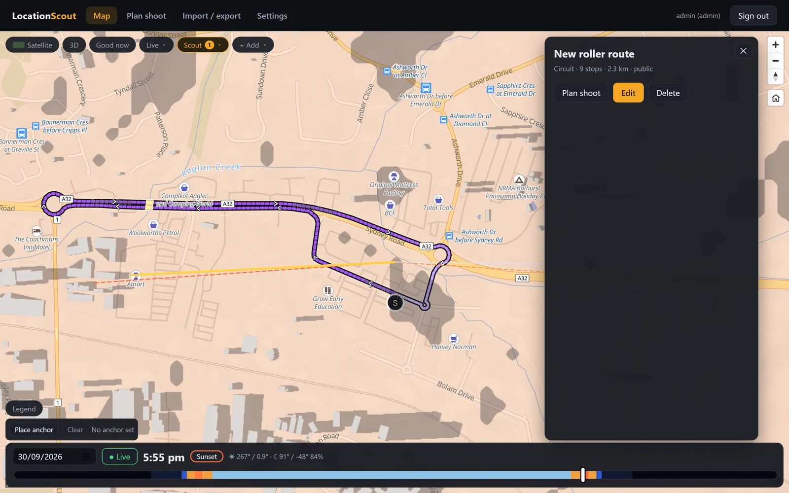 A route | 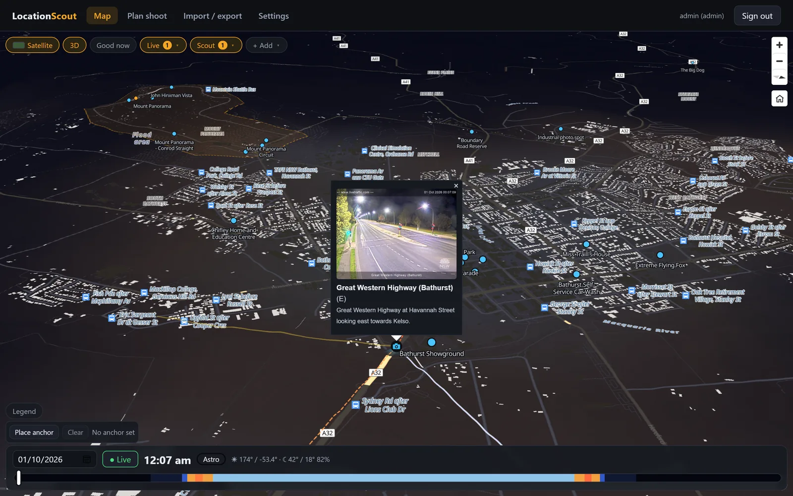 Live traffic camera, 3D at night |
| 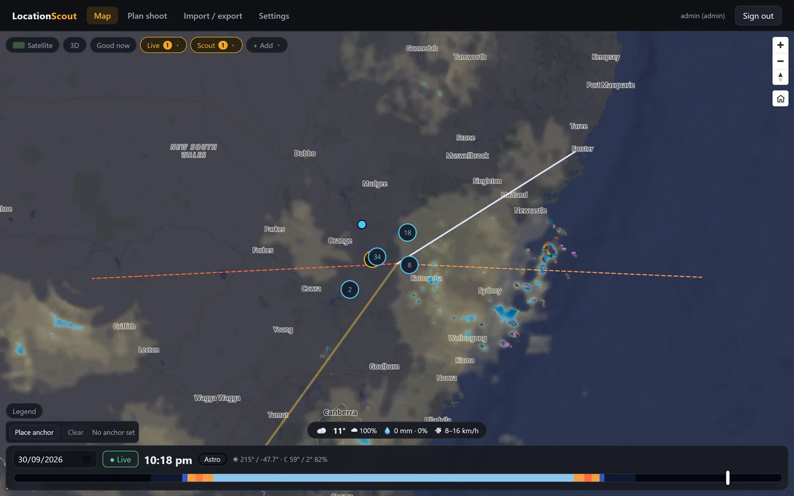 Rain radar and cloud | 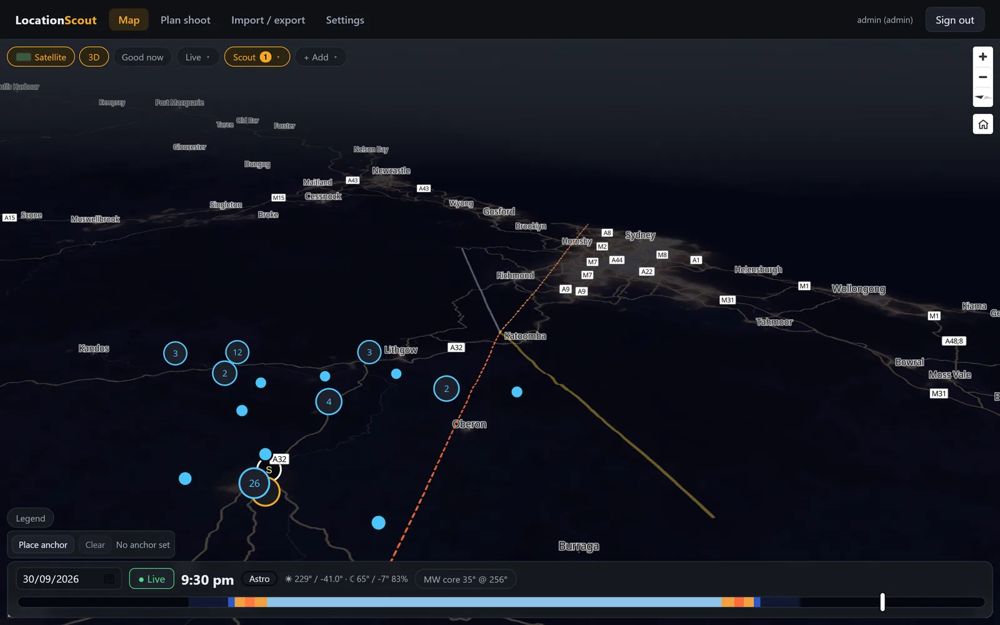 Light pollution |
| 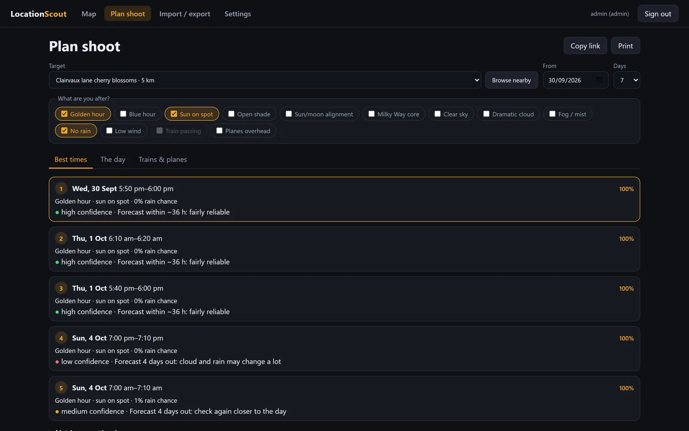 Plan shoot: ranked windows | 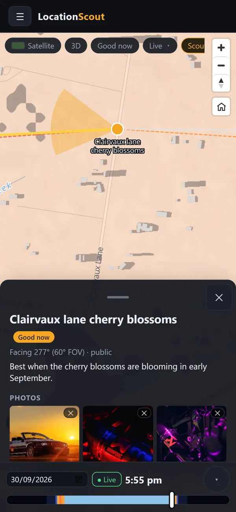 Phone layout |
| 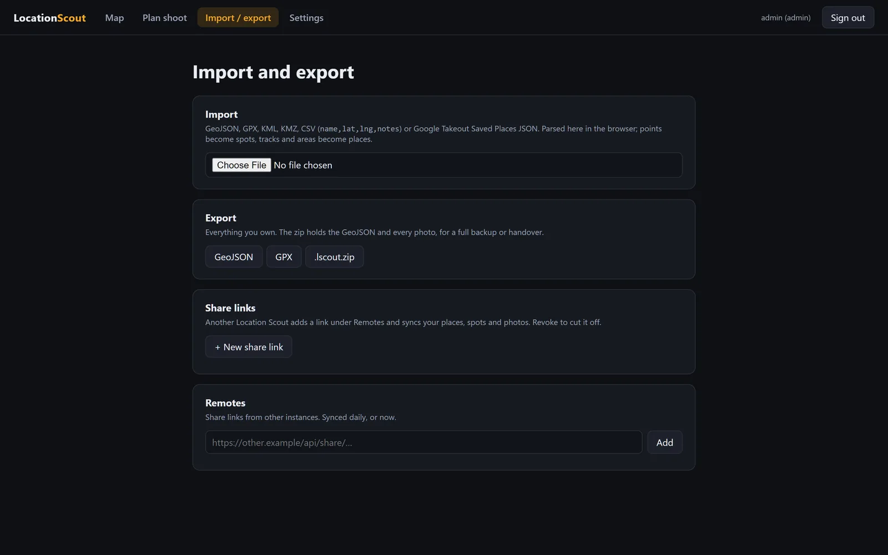 Import, export, share | 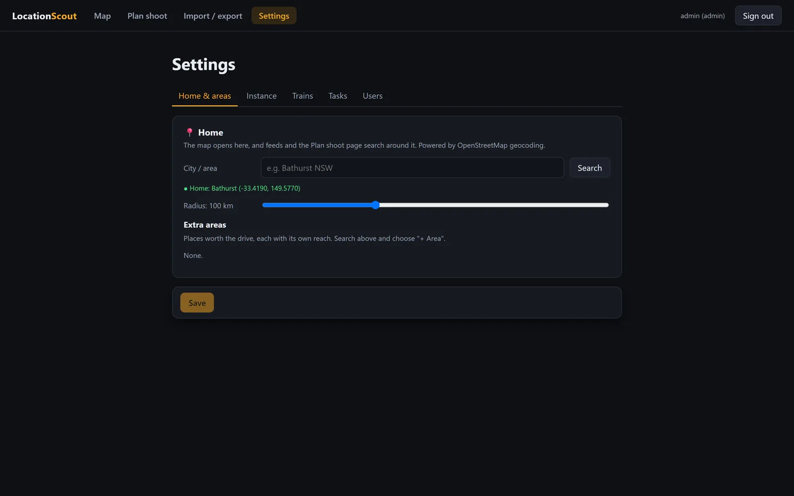 Settings |

## Run it

Needs Node 24.

```bash
npm install
npm run dev
```

Open http://localhost:5174. The API runs on :3003 and Vite proxies `/api` to it. Browsing works straight away; to sign in, set up at least one provider (below).

With Docker, using the published image:

```bash
docker compose pull && docker compose up -d
```

Then open http://localhost:3003 (set `PUBLIC_URL` to match, see below).

> :3003 in dev serves the last `npm run build` of the web app, not your working copy. Use :5174 while developing.

### Signing in

Sign-in goes to Google or Discord and back; this app keeps the provider's id for you, a display name to make a handle from, and your picture. No email address is asked for. A provider only appears on the sign-in page once both its client id and secret are set.

1. Create an OAuth client with the provider and give it the redirect URL `<PUBLIC_URL>/api/auth/google/callback` (or `.../discord/callback`). For local development that is `http://localhost:5174/api/auth/google/callback`.
2. Set `PUBLIC_URL` to the address people reach the app at, with no trailing slash. It has to match exactly: it builds the redirect URL, and a write request whose `Origin` is anything else is refused.
3. Sign in, then open Settings > Account. It shows your account id (`google:1234…`). Put it in `ADMIN_IDS` and sign in again to become an admin. Everyone else is a contributor.

The session cookie is `Secure`, so run it behind HTTPS. Browsers make an exception for `localhost`.

### Driving directions (OSRM)

Drive and snapped routes ask this server for a route (`/api/route`), and the server asks an [OSRM](https://project-osrm.org) instance. In development that is the public demo, which is not for real use. For production, docker-compose includes an `osrm` service on the official image; it needs a one-time preprocess of the Australia extract from Geofabrik. Extracting wants a few GB of memory and takes a while; serving afterwards wants a few GB.

```bash
mkdir -p osrm && cd osrm
curl -LO https://download.geofabrik.de/australia-oceania/australia-latest.osm.pbf

# osrm-extract, osrm-partition and osrm-customize, in that order (the multi-level Dijkstra pipeline)
docker run --rm -v "${PWD}:/data" ghcr.io/project-osrm/osrm-backend osrm-extract -p /opt/car.lua /data/australia-latest.osm.pbf
docker run --rm -v "${PWD}:/data" ghcr.io/project-osrm/osrm-backend osrm-partition /data/australia-latest.osrm
docker run --rm -v "${PWD}:/data" ghcr.io/project-osrm/osrm-backend osrm-customize /data/australia-latest.osrm
cd .. && docker compose up -d
```

The compose file mounts `./osrm` into the `osrm` container and sets `OSRM_URL=http://osrm:5000` for the app. Re-run the three steps on a fresh extract now and then to pick up new roads. The app caches routes for five minutes and asks OSRM for no more than 60 routes a minute per signed-in user.

## Configuration

| Variable | Default | Meaning |
|---|---|---|
| `API_PORT` | `3003` | Server port. |
| `PUBLIC_URL` | `http://localhost:5174` | Where this app is reached from outside, no trailing slash. Sign-in redirects back to it. |
| `GOOGLE_CLIENT_ID`, `GOOGLE_CLIENT_SECRET` | — | Turns on "Continue with Google". |
| `DISCORD_CLIENT_ID`, `DISCORD_CLIENT_SECRET` | — | Turns on "Continue with Discord". |
| `ADMIN_IDS` | — | Comma-separated `provider:id` accounts that are admins, e.g. `google:1234,discord:5678`. Takes effect on their next sign-in. |
| `TRUST_PROXY` | — | Behind a reverse proxy: hops to trust `X-Forwarded-For` from. The proxy must also pass WebSocket upgrades on `/ws` (convoys and live chat); without it chat falls back to polling and convoys do not connect. |
| `DATA_DIR` | `data/` in the repo (`/app/data` in the image) | Where the database and photos are kept. |
| `TFNSW_API_KEY` | — | TfNSW Open Data key, for passenger trains and live traffic cameras. |
| `EVENT_SCOUT_DATA` | `<DATA_DIR>/events` | Where the events engine keeps its own database (`event-scout.db`) and flyers. To bring an existing event-scout across, copy its `data/` folder here. |
| `OSRM_URL` | `https://router.project-osrm.org` | Driving directions for Drive and snapped routes. The default is the public OSRM demo, for development only; in production point it at your own (below). docker-compose sets it to the bundled `osrm` service. |
| `ADSB_URL` | `https://api.adsb.lol` | Planes feed; airplanes.live also works. |
| `OVERPASS_URL` | — | OpenStreetMap Overpass server to try first (rail, suggestions); public mirrors are tried after it. |
| `TZ` | `Australia/Sydney` | What counts as "today" and when daily tasks run. |

Any feed without its key shows "not configured" instead of failing; until an admin sets a location under Settings → Events, the Events page is simply empty.

## How it works

```
server/   Express API, SQLite (node:sqlite), feeds and background tasks
  src/feeds/    planes, trains (GTFS static + realtime), freight, weather, event-scout
  src/events/   the events engine: sources, refresh, culling, geocoding, density, the local model, notifications, its tasks
  src/events.ts the events list for visitors (cut down from the engine, cached a minute) and each user's star/hide
  src/sources/  OSM rail and candidates, Wikimedia Commons
  src/tasks/    scheduled background jobs (remote sync, feed imports)
web/      React 19 + Vite + MapLibre
  src/map/      layers, sun/moon maths, shadow workers, geometry helpers
  src/pages/    Map, Events, Calendar, Plan shoot, Settings, Import/Export
docs/     API reference and research notes
```

- **Sun and moon** positions use [suncalc](https://github.com/mourner/suncalc) in `web/src/map/sun.ts`, all client-side, so the time slider is instant.
- **Shadows** are one raster. Terrain shadows are ray-marched over elevation tiles (AWS Terrain Tiles) in a worker, and building footprints are drawn into the same mask so overlaps don't darken twice.
- **Events.** The engine's own API (`/api/events-admin/*`) is for admins only. Everyone else gets a cut-down list: what the engine has culled or hidden is dropped, only the fields the pages need are passed on, and the result is kept for a minute so visitors can't make the server rebuild it on every request. The crawler, which drives a headless browser against other people's sites, stays a separate container.
- **Remotes and shares.** A share link is a token that returns a GeoJSON bundle. Another instance adds it as a remote and syncs daily. Remote URLs are SSRF-guarded.
- **Trains.** Passenger trains come from TfNSW timetables plus realtime positions. Freight has no public feed ([why](docs/freight-schedule-research.md)), so it's built from logged sightings snapped to the rail network.

Full endpoint list: [docs/api.md](docs/api.md).

### Known limits

- Plane paths are projected 15 minutes by dead reckoning, so turning aircraft drift off.
- Freight prediction stops where a mapped stretch of track ends. It doesn't route across junctions.
- The sun-bearing wedges are approximate near the polar circles.

## Contributing

1. Branch off `master`.
2. Make the change, with a test for any non-trivial logic. Tests use `node:test` in `server/test` and `web/test`. Keep maths and geometry in pure functions so they can be tested without a browser.
3. Check before pushing:
   ```bash
   npm run typecheck
   npm test
   ```
4. Open a PR into `master`. Use [Conventional Commits](https://www.conventionalcommits.org) (`feat(web): …`, `fix(server): …`): release-please builds the changelog and version from them.

CI typechecks and tests every PR, and builds the Docker image. Merges to `master` publish `ghcr.io/kapsikkum/photoscout:latest`.
